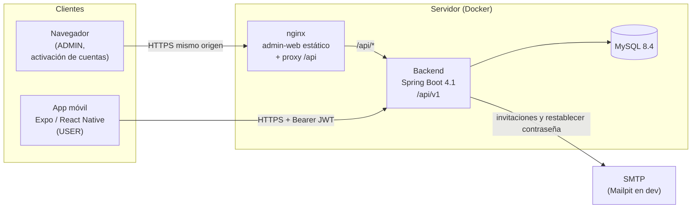

# Arquitectura

Alcance: `docs/scope.md`. Decisiones: [`docs/adr/`](adr/README.md). Seguridad: `docs/security.md`. Convenciones de API: `docs/api.md`. Dominio: `docs/domain.md`.

## Visión general



- **Backend:** monolito modular, API REST stateless con JWT (ADR 0002, 0005). Única fuente de verdad del contrato (OpenAPI).
- **Admin-web:** SPA React servida por nginx, que también hace proxy de `/api` al backend ⇒ mismo origen, sin CORS con credenciales. En dev, el proxy lo hace Vite.
- **Mobile:** app Expo para usuarios; habla directo con la API.
- **Mailpit** (solo dev) captura los mails de invitación y restablecer contraseña.

## Estructura del repo

```
apps/
  backend/        Spring Boot (Maven wrapper) — fuera del workspace pnpm
  admin-web/      React + Vite + Mantine
  mobile/         Expo + expo-router
packages/
  api-types/      Tipos TS generados desde OpenAPI (no editar)
infra/docker/     Dockerfiles, nginx, entrypoints de dev, config MySQL
scripts/          Helpers .sh (Mac) y .ps1 (Windows) equivalentes
docs/             Esta documentación, adr/, agents/, brand/
```

## Estructura interna

### Backend (`com.example.app`)

```
config/
common/{exception,security,validation,persistence,web,mail}
modules/<modulo>/{controller,service,repository,entity,dto/request,dto/response,mapper,exception}
```

Módulos incluidos: `auth` (login, refresh rotativo, invitación, restablecer contraseña, sesiones) y `users` (alta/administración de usuarios, seed de dev). Los módulos del producto se crean cuando una tarea los necesita. Reglas de capas en ADR 0002.

**Persistencia:** siempre Hibernate (ORM de JPA vía Spring Data JPA). Regla fija: no se reemplaza por otro ORM ni por acceso a datos sin ORM (MyBatis, jOOQ, JDBC, etc.).

### Admin-web (`apps/admin-web/src`)

```
app/        Providers (Mantine, QueryClient, Router), layout, bootstrap de sesión
features/   <feature>/{api,components,hooks,pages,schemas,types,index.ts}
shared/     api (axios + interceptores), ui, hooks, utils, auth (guards)
routes/     Definición de rutas y guards por rol
theme/      Tema Mantine
```

Una feature importa de otra solo vía su `index.ts`. Páginas públicas: `/login`, `/activar?token=`, `/olvide-contrasena`, `/restablecer?token=`.

### Mobile (`apps/mobile`)

```
app/                 Rutas expo-router
  (auth)/            Login (sin sesión)
  (app)/             Pantallas con sesión (USER)
src/
  features/<feature>/{api,components,hooks,schemas,types,index.ts}
  shared/            api, ui (componentes base), hooks, utils, storage (secure-store)
  theme/             Tokens del design system (ADR 0006)
```

## Contrato de API → tipos

1. El backend expone OpenAPI en `/v3/api-docs` (springdoc; Swagger UI solo en perfil dev).
2. `scripts/gen-api-types.sh|.ps1` descarga el spec a `packages/api-types/openapi.json` y genera `src/schema.d.ts` con openapi-typescript.
3. Se commitean ambos archivos: el cambio de contrato se ve en el diff.
4. admin-web y mobile importan de `@app/api-types`; si el contrato cambió, el typecheck lo marca.

## Puertos en desarrollo

| Servicio | Puerto host | Variable |
|---|---|---|
| Backend API | 8080 | `BACKEND_HOST_PORT` |
| Backend debug (JDWP) | 5005 | `BACKEND_DEBUG_PORT` |
| Admin-web (Vite dev) | 5173 | `ADMIN_WEB_DEV_HOST_PORT` |
| Admin-web (nginx, build) | 8088 | `ADMIN_WEB_HOST_PORT` |
| Metro (Expo) | 8081 | `EXPO_HOST_PORT` |
| Mailpit UI | 8025 | `MAILPIT_UI_HOST_PORT` |
| Adminer | 8089 | `ADMINER_HOST_PORT` |
| MySQL | 3306 | `MYSQL_HOST_PORT` |

Entorno de dev y polling de archivos: ADR 0007.

## Índice de ADRs

| # | Título |
|---|---|
| [0001](adr/0001-stack.md) | Stack y versiones fijadas |
| [0002](adr/0002-backend-modular-monolith.md) | Backend como monolito modular |
| [0003](adr/0003-monorepo-pnpm.md) | Monorepo con pnpm workspaces |
| [0004](adr/0004-schema-hibernate-ddl-update.md) | Esquema con `ddl-auto=update` (transitorio, Flyway antes de prod) |
| [0005](adr/0005-auth-jwt.md) | Autenticación JWT + refresh rotativo |
| [0006](adr/0006-ui-libraries.md) | Librerías de UI |
| [0007](adr/0007-dev-environment-docker.md) | Entorno de desarrollo en Docker |
| [0009](adr/0009-session-revocation.md) | Revocación inmediata de sesiones (claim `sid`) |
